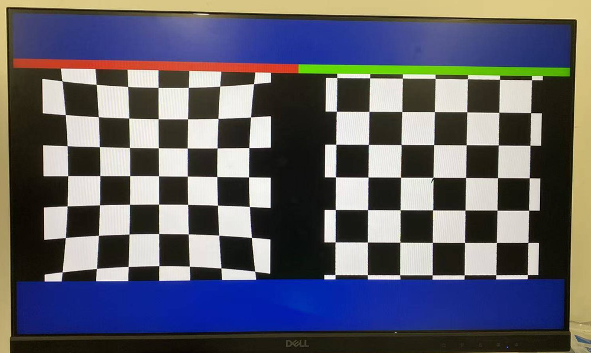
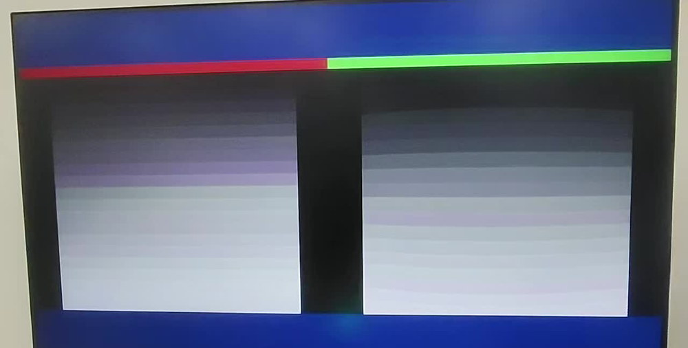
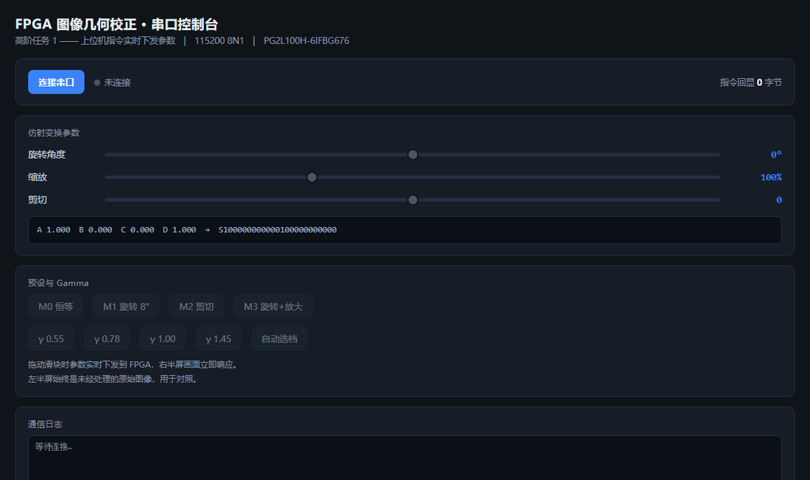
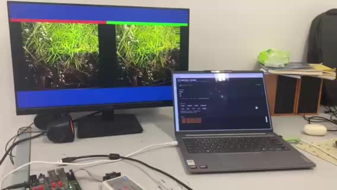

# 基于紫光同创 PG2L100H 的实时视频几何校正与显示系统

在紫光同创 Logos2 系列 **PG2L100H-6IFBG676**（MES2L676-100HP 开发板）上实现的全硬件实时视频几何校正链路：
仿射几何变换 → 二阶径向/切向畸变校正 → 双线性插值 → 自适应 Gamma → 1280×720@60 输出。
整条通路不含 CPU、不含帧缓存回读，流水线深度固定，延迟恒为 9 拍（约 121 ns）。



*同一帧分屏输出：左半屏 `raw_sel=1` 直通，为 ROM 中的畸变原图（格线弯曲）；右半屏经二阶径向/切向校正后恢复为规则棋盘格。*

## 1. 功能一览

| 分类 | 功能 | 说明 |
| --- | --- | --- |
| 输入 | 片内 ROM 图像源 | 512×512 测试图，按像素奇偶拆成 4 个 256×256 bank，RGB565 + Bayer 抖动 |
| 输入 | HDMI 接收链路 | MS7200 + TMDS 采样前端，RTL 已实现；本板硬件受限，见第 8 节 |
| 输出 | 720p60 TMDS | MS7210 I2C 配置 49 条寄存器，27 MHz → 74.25 MHz 像素时钟 |
| 几何 | 仿射变换 | 旋转 / 剪切 / 缩放，6 个系数 Q12/Q8，支持串口在线下发 |
| 几何 | 畸变校正 | 二阶径向 k1·r² + k2·r⁴ 与切向 p1/p2，归一化 S_Q16 消除黑边 |
| 插值 | 双线性 | 4 邻域加权，9 级流水 |
| 画质 | 自适应 Gamma | 4 档曲线，按帧亮度/对比度自动选档，LUT 实现 |
| 交互 | 串口指令 | 115200 8N1，S/M/G/D 四条指令，字节回显 |
| 交互 | 上位机控制台 | 网页版 Web Serial 直连，滑块实时改参数 |

## 2. 信号链

```
27 MHz (D18)
   ├─ PLL 74.25 MHz ─┬─ img_path：仿射 → 畸变校正 → 双线性 → Gamma
   │                 └─ video_timing_720p ─→ DE/HS/VS/PCLK
   ├─ ms7210_cfg（I2C，49 条寄存器）─→ MS7210 ─→ TMDS 输出
   ├─ uart_cmd（115200）←─ 上位机滑块
   └─ ROM 4 bank（dp_ram_img）─→ img_path
```

流水线分级（`img_correct_top.v` 中 `img_path` 段）：

| 级 | 运算 |
| --- | --- |
| S1 | 坐标生成（pix_x/pix_y → 归一化） |
| S2–S3 | 仿射矩阵（a,b,c,d,tx,ty） |
| S4 | 二阶径向 k1·r²、k2·r⁴ |
| S5–S6 | 切向 p1/p2 与总偏移合成 |
| S7 | 逆映射取整 + 边界钳位 |
| S8 | 4 邻域地址生成（4 bank 并行） |
| S9 | 双线性加权 |
| S10 | Gamma LUT |

## 3. 实测指标

| 项目 | 数值 |
| --- | --- |
| 器件 | PG2L100H-6IFBG676，速度等级 −6 |
| DRM | 129.5 / 155（83.5%） |
| APM | 33 / 240 |
| LUT | 1472 |
| 寄存器 | 1404 |
| IO | 36 / 300 |
| 最差建立余量 | +1333 ps |
| TNS | 0 |
| 流水线延迟 | 9 拍 @74.25 MHz ≈ 121 ns（含 Gamma 10 拍 ≈ 135 ns） |
| 校正精度 | 六格宽度 111/107/111/110/113/112 px，标准差 1.7% |
| 中心格宽比 | 1.204（校正后）vs 1.198（理想），偏差 0.5% |

## 4. 实测效果

照片均为开发板实际上屏拍摄，未做后期处理；拍摄产生的摩尔纹来自相机与屏幕像素栅格的干涉，不属于输出画面缺陷。

### 4.1 畸变校正

同一帧画面左右分屏（见文首对比图）：左半屏走 `raw_sel=1` 直通支路，输出 ROM 中未经校正的畸变原图，格线呈明显桶形弯曲、边角格子被压缩；右半屏经二阶径向 `k1·r² + k2·r⁴` 与切向 `p1/p2` 校正，格线恢复笔直，边缘黑边由归一化因子 `S_Q16 = 54700` 消除。两侧取自同一 ROM 图像、同一时钟域，像素差异完全由校正系数决定。

### 4.2 自适应 Gamma



*灰阶渐变条：左半屏 γ=1.00 原样输出，右半屏自动选档到 γ=0.55。*

暗部相邻灰阶的间距被明显拉开，同时最亮端的方块没有并阶或截顶。选档逻辑在每一帧消隐期统计亮度均值与对比度，映射到 4 档曲线中最近的一档，下一帧生效，因此调节过程无可见跳变。

### 4.3 上位机串口控制台



*网页版控制台，Chrome/Edge 原生 Web Serial 直连 CP2102，115200 8N1。*

三组滑块分别对应仿射矩阵的旋转、剪切、缩放分量，拖动即下发 `S` 指令，寄存器在下一帧垂直消隐时整组锁存，画面无撕裂。下方状态区回显实际字节数，用于确认指令被完整接收。

### 4.4 整机联调



*MES2L676-100HP 底板 + DELL 显示器 + 笔记本控制台同时工作。*

## 5. 目录结构

```
01_工程文件/
    img_correct.pds        PDS 工程，双击直接打开
    hdmi_loop_tx.fdc       引脚约束（HDMI 输出、I2C、UART、LED）
    source/
        img_correct_top.v          顶层 + 校正流水线 + 仿射 + uart_cmd + Gamma
        ms7210_cfg.v               MS7210 发送芯片 I2C 配置（含 SDA 仲裁）
        i2c_master.v               I2C 主机底层时序
        img_correction.v           早期畸变校正（对照用）
        resample_interp.v          早期插值（对照用）
        distort_correct_pipe.v     早期流水线（对照用）
        timing_640x480.v           早期 VGA 时序（对照用）
        vga_driver.v               早期 VGA 驱动（对照用）
    ipcore/                PLL 与双口 RAM（PDS 生成，可直接综合）

02_上位机串口控制台/
    control.html           网页控制台（Chrome / Edge 原生 Web Serial）
    start_console.bat      本地起服务并打开浏览器

03_脚本与参数/
    gen_rom_img.py         测试图 → 4 bank hex 打包
    apply_sda_fix.py       I2C SDA 仲裁补丁
    build_chain.sh         一键编译
    build_gamma_demo.sh    Gamma 演示版编译
    gam_lut.hex            Gamma 查找表（4 档 × 256 点）
    rom_ee/eo/oe/oo.hex    ROM 图像数据

docs/images/               README 插图（上屏实拍）
```

## 6. 快速开始

**综合与烧录**

1. Pango Design Suite 2022.2-SP6.4 打开 `01_工程文件/img_correct.pds`
2. 直接 *Generate Bitstream*，产物为 `generate_bitstream/img_correct_top.sbit`
3. Tools → Configuration → 选择 sbit → 下载

命令行等价写法：

```bash
cd 01_工程文件
<PDS安装路径>/bin/pds_shell.exe -project img_correct.pds -run gen_bit_stream
```

**上位机控制台**

双击 `02_上位机串口控制台/start_console.bat`（需已装 CP210x 驱动），浏览器打开后用 Web Serial 选择 COM 口，115200 8N1。

## 7. 串口指令协议

115200 8N1，ASCII，末尾回车，每字节原样回显。

| 指令 | 含义 |
| --- | --- |
| `S` + 24 个十六进制字符 | 写入 a,b,c,d,tx,ty 六个仿射系数（a~d 为 Q12，1.0 = 4096；tx/ty 为 Q8 有符号） |
| `M0` ~ `M3` | 回到内置预设，关闭自定义矩阵 |
| `G0` ~ `G4` | 固定 Gamma 档 0~3；`G4` 恢复自适应 |
| `D` | 全部参数恢复默认 |

示例：`S10000000000001000000000000000`（恒等矩阵）

## 8. 已知限制

采集侧 30 根信号的引脚分配与采样时序均按官方参考设计实现，但**本板 HDMI 接收前端存在硬件问题**：厂商 2025-02-20 预编译的 `HDMI_IN_DDR3_HDMI_OUT_top.sbit`（同型号 PG2L100H、同引脚、1920×1080@60）在完全相同的条件下同样无法建立稳定画面（顶部噪声带、中部黑、底部白带）。

四条独立证据——纯绿源采回中灰、24 格测试图全红、四相位扫描全部失败、官方 bit 同样失败——指向 MS7200 → FPGA 的引脚链路，而非 RTL。

因此交付版本以片内 ROM 图像源作为输入，以稳定复现校正链路。更换可用的采集源后，帧缓存与校正流水线**无需任何改动**。

## 9. 编译参数

`img_correct_top.v` 顶部：

| 参数 | 说明 |
| --- | --- |
| `GAMMA_EN` | 1 = 开启自适应 Gamma |
| `GAMMA_DEMO` | 1 = 四档曲线每 5 秒循环（演示用），0 = 按帧均值自动选档 |
| `AF_EN` | 1 = 开启仿射变换，每 5 秒轮换四种预设 |
| `S_Q16` | 归一化因子 54700（s = 0.83466），用于消除校正后黑边 |
| k1/k2/p1/p2 | 三套系数并存，改 4 行常数即切换桶形/枕形/纯径向 |

## 10. 开发环境

| 项目 | 版本 |
| --- | --- |
| FPGA | 紫光同创 Logos2 PG2L100H-6IFBG676 |
| 开发板 | MES2L676-100HP（核心板 + 底板） |
| EDA | Pango Design Suite 2022.2-SP6.4 |
| 脚本 | Python 3（仅用于算法建模与图像源生成，不参与综合） |
| 上位机 | Chrome / Edge 89+（Web Serial） |
